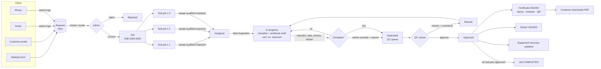

# TUV EAST — Inspection Management System (IMS)
### Functional & technical specification · v1.0 · 14-Oct-2026

Covers the workflow **Client Request → Admin Assignment → Inspector Job/Sub-Job → Checklist → QC Review → Certificate & Sticker**, implemented in this repository (PHP 8 / MariaDB, XAMPP). Section 12 lists the points that need your confirmation.

---

## 1. Functional requirements

### 1.1 Client request management (FR-REQ)
| ID | Requirement | Implemented in |
|---|---|---|
| REQ-1 | Accept requests from **website** (public form, no login), **email** and **phone** (logged by admin), and **customer portal**. | `/request`, `/admin/requests/new`, `/portal/requests/new` |
| REQ-2 | Every request gets a reference `REQ-YYYY-NNNN`, records channel, company, contact, location, P.O., preferred date, notes and 1..n equipment items (service type, description, ID, qty). | `service_requests`, `service_request_items` |
| REQ-3 | Auto-match the request to a registered client by email; otherwise the client can be registered while converting. | `RequestService::create/convert` |
| REQ-4 | Status: New → Under Review → Quoted → Converted / Rejected / Cancelled, with a note visible to the customer. | `Workflow::TRANSITIONS['request']` |
| REQ-5 | Convert to a job: each item × quantity becomes one sub-job; equipment is registered automatically. | `/admin/requests/{id}/convert` |
| REQ-6 | Website form protected by honeypot + per-session rate limit (no CAPTCHA). | `PublicController::requestSubmit` |

### 1.2 Admin — inspectors, jobs, assignment (FR-ADM)
| ID | Requirement |
|---|---|
| ADM-1 | Create/register users for all four portals; inspectors have employee no., qualification (printed on certificates), qualification expiry, base location, **qualified inspection types**, uploaded signature. |
| ADM-2 | Create jobs directly or from a request; a job holds client, title, location, P.O., schedule, due date, priority, notes, lead inspector. |
| ADM-3 | Add sub-jobs (inspection type + registered or new equipment); numbering `JOB-2026-0001.1`, shown as **1.1, 1.2 …** |
| ADM-4 | Assign different inspectors to different sub-jobs, in bulk (select sub-jobs → inspector) or the whole job at once. |
| ADM-5 | Assignment guard: inspector must be active and **qualified** for the sub-job's inspection type; submitted/approved sub-jobs cannot be reassigned. Full assignment history kept. |
| ADM-6 | Assignment Board: all unassigned sub-jobs by priority/date with inspector workload and expiring qualifications. |
| ADM-7 | Cancel sub-jobs/jobs with reason (blocked once work is submitted/approved); force-submit an incomplete inspection with an override reason. |
| ADM-8 | Manage clients, equipment register, inspection types, checklist & certificate templates, sticker stock, certificates (revoke), settings, audit log. |

### 1.3 Inspector portal (FR-INS)
| ID | Requirement |
|---|---|
| INS-1 | "My Day": rework first, then in-progress, then scheduled; KPIs; qualification-expiry warning. |
| INS-2 | Assigned jobs listed as main jobs with nested sub-jobs; only own sub-jobs are visible. |
| INS-3 | **Start inspection** creates the checklist + certificate drafts using the active template versions and reserves the certificate number. |
| INS-4 | Checklist: PASS / FAIL / N/A per item + remarks; "mark unanswered as pass" per section; **autosave**; progress bar; works on phones. |
| INS-5 | Certificate data: system-bound fields are read-only (client, location, procedure, standard, equipment …); inspector fills technical fields, dates, result (Accepted / Rejected / Repair), statement and remarks; consumable data carries over from the previous certificate. |
| INS-6 | Photos/documents upload (camera capture on mobile); up to 4 photos print in the certificate image area; signed PDF upload when a type has no template. |
| INS-7 | Record the sticker number affixed on site (must exist in stock). |
| INS-8 | Submit to QC only when the completeness rules pass (§9.1); then record locks. |

### 1.4 QC portal (FR-QC)
| ID | Requirement |
|---|---|
| QC-1 | Review queue (urgent & oldest first), side-by-side certificate/checklist preview, failed items & remarks, photos, completeness warnings, override flag. |
| QC-2 | **Approve & issue** → certificate issued (issue date, "Reviewed By", signature, stamp, QR), sticker issued, equipment next-due date updated, customer notified. |
| QC-3 | **Return for rework** with mandatory comments → inspector notified, documents back to draft. |
| QC-4 | Four-eyes rule: a reviewer cannot approve their own inspection. |

### 1.5 Customer portal (FR-CUS)
Overview with KPIs and overdue alerts · submit requests · request status & notes · jobs with live progress · download **approved** certificates/checklists as PDF · equipment register with due dates · CSV export. Every query is scoped to the user's client.

### 1.6 Documents (FR-DOC)
| Document | Layout | Generated from |
|---|---|---|
| Checklist | Exact F-7.5.1-CL 01 pattern: header band, title row, Certificate No./Serial No., DESCRIPTION/PASS/FAIL/N/A/REMARKS, ☒/☐ boxes, Inspector Name/Signature/Date block, side Doc-Ref text, footer band, "Page \| n"; 27 rows on page 1 like the form. | `checklist_templates` + `checklist_responses` |
| Certificate / report | Exact F-7.5.1-06 pattern: underlined title, 2×(label/value) grid in #AABEE3, image area, Result row (Accepted grey / Rejected pink / Repair peach), statement, Remarks \ Notes with standard notes, Inspector/Reviewed By/Signature block, stamp, verification QR in footer. | `certificate_templates` + `certificates.data` |
| Sticker | 90 mm label, green/red, sticker no., certificate no., equipment, dates, QR. | `stickers` |

Preview in browser (print-ready A4) and PDF download (Dompdf, Calibri/Carlito). Drafts carry a DRAFT watermark; revoked certificates a REVOKED watermark. Public verification at `/verify` (QR) shows only issued/revoked certificates.

### 1.7 Dashboards (FR-DSH)
Admin: new requests, sub-jobs awaiting inspector, assigned/in progress, awaiting QC, completed checklists, certificates issued/pending, stickers stock/issued/reserved, open vs completed jobs, sub-job pipeline, certificates per month, needs-assignment list, inspector workload, equipment due, recent activity. Inspector, QC and Customer have their own dashboards (above).

### 1.8 KPI scorecards & Excel export (FR-KPI)
Separate scorecards per portal — **Admin → KPI & Reports**, **Inspector → My KPIs**, **QC → QC KPIs** (admins can open any inspector's or reviewer's scorecard). Every KPI shows the value for the selected period (7 / 30 / 90 days, this / last month, quarter, YTD or custom dates), the target, a status (**On target** · **Watch** = within 10 % · **Off target**) and the change against the previous period of equal length. Targets and the on-time grace days are editable by the admin (*Targets*), stored in `settings` as `kpi_target_*` / `kpi_sla_days`.

| Portal | KPIs (target) |
|---|---|
| Admin | Requests received · Request → job conversion (≥ 80 %) · Request response time (≤ 24 h) · Assignment lead time (≤ 24 h) · Inspections completed · Certificates issued · On-time completion (≥ 90 %; due date, or scheduled date + grace days) · Job cycle time (≤ 7 d) · QC first-pass yield (≥ 90 %) · Unassigned backlog now (≤ 5) · Overdue inspections now (0) · Re-inspections due in 30 days. Plus monthly output & FPY trend, requests by channel, inspector productivity table (drill-down), QC team summary (drill-down), client volume, completed by inspection type. |
| Inspector | Inspections approved (≥ 20) · submitted · Avg. inspection time start → submit (≤ 8 h) · Assignment → approval (≤ 5 d) · First-pass QC approval (≥ 90 %) · Rework returns (≤ 2) · On-time submission (≥ 90 %, scheduled date + 1 day) · Open workload now · Overdue items now (0). Plus weekly trend, anonymous team benchmark & rank, by-type breakdown, QC return comments, 6-month history. |
| QC | Reviews completed · Avg. review time submission → decision (≤ 24 h) · Reviewed within 24 h (≥ 90 %) · Approval / rework rate · Certificates issued · Queue now (≤ 5) · Oldest waiting (≤ 24 h). Plus turnaround distribution, weekly decisions, team totals, rework rate per inspector. |

All durations come from workflow timestamps (`service_requests.created_at`, `job_assignments.assigned_at`, `sub_jobs.started_at / submitted_at / approved_at`, `qc_reviews.created_at`, `jobs.completed_at`); review time uses the latest `inspection.submitted` audit event before each decision, so re-submissions after rework are measured correctly. Logic: `app/services/KpiService.php`.

**Excel export.** Each scorecard has *Export to Excel* producing a multi-sheet .xlsx (Admin: Summary, Inspectors, Clients, Request channels, Inspection types, Monthly trend, Inspection detail with every workflow timestamp; Inspector: Summary, Team benchmark, My inspections, By type, QC returns, Trend; QC: Summary, My reviews, Turnaround, Inspector quality, QC team). The summary sheet carries value, previous period, target, direction and a colour-coded status. Every list page (requests, jobs, certificates, stickers, clients, equipment, users, audit log, customer certificates & equipment) now offers **Excel** next to CSV. Workbooks are generated by a dependency-free writer (`app/core/Xlsx.php`): typed numbers / percentages / dates, styled frozen header, auto-filter, and protection against spreadsheet formula injection. Exports are audit-logged.

**Demo data.** `database/demo_history.php` (run by the installer) adds 6 months of realistic history — 46 jobs / 111 inspections across three inspectors and two QC reviewers, with rework, late starts, response and review delays, non-converted requests, overdue work and equipment coming due — so the scorecards show meaningful values.

### 1.9 Non-functional
Role-based access on every route + ownership checks · CSRF on all POSTs · bcrypt passwords, login throttling, session timeout (120 min) · prepared statements only · output escaping · upload MIME sniffing + size limit, files outside web root (`storage/`, blocked by `.htaccess`) · audit log of all state changes, logins, downloads, exports · search, filters, sorting, pagination, CSV export on all lists · responsive (desktop, tablet, phone; checklist designed thumb-first).

---

## 2. Workflow diagram

---

## 3. Database schema (`database/schema.sql`)

All tables InnoDB, utf8mb4. PK = `id` unless stated.

| Table | Key columns | Foreign keys |
|---|---|---|
| **clients** | code (UNIQUE, used in certificate no.), name, contact_person, email, phone, address, city, vat_no, status | — |
| **users** | name, email (UNIQUE), password_hash, role `admin/inspector/qc/customer`, phone, signature_path, status, last_login_at | client_id → clients (customers) |
| **inspector_profiles** | PK user_id, employee_no, qualification, cert_no, cert_expiry, base_location | user_id → users |
| **inspector_skills** | PK (user_id, inspection_type_id) | → users, → inspection_types |
| **inspection_types** | code (UNIQUE), name, category, procedure_ref, standard_ref, validity_months, requires_checklist/certificate/sticker, status | — |
| **checklist_templates** | code, title, doc_ref, revision, revision_date, **version**, is_active | inspection_type_id → inspection_types |
| **checklist_template_items** | section, label, is_mandatory, sort_order | template_id → checklist_templates |
| **certificate_templates** | code, title, doc_ref, revision, revision_date, **fields (JSON)**, result_options, default_statement, notes, inspector_label, show_image_area, version, is_active | inspection_type_id → inspection_types |
| **equipment** | description, equipment_no, serial_no, manufacturer, model, capacity, year_built, location, last/next_inspection_date, status | client_id → clients, inspection_type_id → inspection_types |
| **service_requests** | request_no (UNIQUE), channel, company_name, contact_name, email, phone, location, po_no, preferred_date, description, status, status_note | client_id → clients, received_by/submitted_by → users, converted_job_id → jobs |
| **service_request_items** | equipment_description, equipment_no, quantity, notes | request_id → service_requests, inspection_type_id → inspection_types |
| **jobs** | job_no (UNIQUE), title, location, po_no, scheduled_date, due_date, priority, status *(derived)*, notes, completed_at | client_id → clients, request_id → service_requests, lead_inspector_id/created_by → users |
| **sub_jobs** | seq, sub_job_no (UNIQUE; UNIQUE(job_id,seq)), scheduled_date, status, result, started/submitted/approved_at, override_by, override_reason | job_id → jobs, inspection_type_id, equipment_id, inspector_id → users |
| **job_assignments** | assigned_at, released_at, note *(history)* | job_id, sub_job_id, inspector_id, assigned_by |
| **checklists** | serial_no, inspection_date, status draft/completed | sub_job_id (UNIQUE) → sub_jobs, template_id → checklist_templates, inspector_id |
| **checklist_responses** | PK (checklist_id, item_id), result pass/fail/na, remarks | → checklists, → checklist_template_items |
| **certificates** | certificate_no (UNIQUE), source generated/uploaded, data (JSON), result, result_statement, remarks, inspection/issue/next dates, status, verify_token (UNIQUE), revoked_reason | sub_job_id (UNIQUE), template_id, inspector_id, reviewer_id |
| **qc_reviews** | decision approved/rework, comments | sub_job_id, reviewer_id |
| **stickers** | sticker_no (UNIQUE), batch_no, color, status, issued_at, expiry_date, void_reason | sub_job_id, equipment_id, certificate_id, inspector_id |
| **attachments** | kind photo/certificate_upload/document, file_path, original_name, mime, size, caption, on_certificate | sub_job_id, uploaded_by |
| **notifications** | title, body, link, read_at | user_id |
| **audit_logs** | action, entity_type, entity_id, details (JSON), ip_address | user_id |
| **number_sequences** | PK (name, period), last_value — atomic counters | — |
| **settings** | PK key, value | — |

Relationship chain: `client 1─n job 1─n sub_job 1─1 checklist / 1─1 certificate / 0..n sticker / n attachments`, `sub_job n─1 inspector`, `sub_job n─1 equipment n─1 client`. Templates are **versioned**: a template referenced by any document is never edited in place — saving creates version n+1, so issued documents always re-render identically.

---

## 4. Portal module structure

| Admin | Inspector | QC | Customer |
|---|---|---|---|
| Dashboard · Global search | My Day | Dashboard | Overview |
| Client Requests (list, log email/phone, detail, status, convert) | Assigned Jobs (job → sub-jobs) | Review Queue | Inspection Requests (+ new) |
| Jobs & Sub-jobs (list, create, detail, bulk assign, add/cancel sub-job, override) | Inspection workspace: Checklist · Certificate · Photos & files · Sticker · Submit | Review (certificate/checklist preview, decision) | Jobs & Progress |
| Assignment Board | Submitted & Approved | My Decisions | Certificates (PDF) |
| Certificates (revoke) · Stickers (batches, void) · Templates (types, checklist & certificate builders, preview, versions) | Profile & signature | Issued Certificates | Equipment Register |
| Clients · Equipment · Users & Inspectors (qualifications, signature) · Audit Log · Settings | Notifications | Profile & signature | Profile |

---

## 5. API & routes

**Web routes** are listed in `index.php` (single front controller). JSON API v1 uses the portal session cookie; POST requires header `X-CSRF-Token`. Errors: `{ "error": "…" }` with 401/403/404/419/422.

| Method | Endpoint | Roles | Purpose |
|---|---|---|---|
| GET | `/api/v1/me` | any | current user |
| GET | `/api/v1/dashboard` | any | role-specific counters |
| GET | `/api/v1/jobs?status=&limit=` | admin, inspector (own), qc | job list |
| GET | `/api/v1/jobs/{id}` | admin, inspector (own sub-jobs), qc | job + sub-jobs + progress |
| GET | `/api/v1/inspectors?type={id}` | admin | qualified inspectors with workload |
| GET | `/api/v1/clients/{id}/equipment` | admin | equipment for job form |
| POST | `/api/v1/subjobs/{id}/checklist` | assigned inspector, admin | autosave `r[item][result|remarks]`, serial_no, inspection_date → stats |
| POST | `/api/v1/subjobs/{id}/certificate` | assigned inspector, admin | autosave fields[], result, statement, remarks, dates |
| GET | `/api/v1/subjobs/{id}/validation` | inspector (own), admin, qc | completeness issues |
| GET | `/api/v1/notifications` | any | latest + unread count |
| GET | `/api/v1/verify/{certificateNo}` | public | validity |

Business logic lives in `app/services/` (controllers stay thin): `RequestService`, `ClientService`, `JobService` (create, addSubJob, assign, assignJob, unassign, cancel, recompute, progress), `InspectionService` (start, saveChecklist, saveCertificate, reserve/releaseSticker, issues, submit, attachments), `QcService` (approve, rework), `CertificateService` (revoke, field binding), `StickerService`, `TemplateService` (versioned save), `DocumentService` (models, QR, PDF). All multi-table writes run in DB transactions; all status changes go through `Workflow::assert()`.

---

## 6. Frontend page structure & navigation
Public: Home (services, how it works, verify box) → Request form → Thank-you (reference no.) · Verify certificate · Sign in.
Each portal: fixed left sidebar (role-coloured — admin navy, inspector teal, QC violet, customer blue), sticky top bar (breadcrumbs, admin global search, notifications), content area. Lists = filter toolbar + segmented status tabs + table (cards on phones) + pager + CSV export. Detail pages = header with status badges and primary action, workflow stepper, main column + side panel. Modals for short actions (status, assign, cancel, revoke, override). Documents open in an A4 preview with Print / Download PDF.

---

## 7. Job & sub-job assignment logic
1. A sub-job = one inspection type × one equipment item; quantity n creates n sub-jobs.
2. `assign(subJobIds, inspector)` per sub-job: inspector active & role inspector → qualified (`inspector_skills`) → transition allowed (`pending|assigned|in_progress → assigned`; `rework` keeps rework) → release previous assignment row → insert history → notify inspector → set job lead if empty.
3. Whole-job assignment assigns only the sub-jobs the inspector is qualified for and reports the rest.
4. **Job status is derived** from sub-jobs (`JobService::recompute`, run after every change): none/all unassigned → *Awaiting assignment*; all approved → *Completed*; all submitted/approved → *Under review*; any in progress/rework/submitted/approved → *In progress*; otherwise any unassigned → *Awaiting assignment*; else *Assigned*. Cancelled sub-jobs are ignored.

## 8. Checklist, certificate & sticker logic
- **Start**: creates checklist (active checklist template) and certificate (active certificate template, `certificate_no` from the numbering pattern, `verify_token`, inspection date = today, next date = today + validity − 1 day). Manual fields marked *carry over* are pre-filled from the inspector's last certificate of the same type.
- **Checklist autosave** accepts only items of the checklist's own template version.
- **Certificate**: bound fields are resolved at render time from client/job/type/equipment/certificate; manual fields validated (dropdown values must be in the option list).
- **Sticker**: stock created in numbered batches → inspector records the sticker affixed (`in_stock → reserved`) → QC approval issues it (`reserved → issued`, linked to certificate & equipment, expiry = next inspection date) → revoke or admin action voids it. Cancelling a sub-job returns a reserved sticker to stock.
- **QC approve**: certificate `issued` (issue date, reviewer), equipment last/next dates updated (*Rejected* → equipment out of service), customer notified, job recomputed.
- **Revoke** (admin, reason required): certificate `revoked`, sticker void, sub-job back to rework, public verification shows *revoked*.

## 9. Validation, status transitions & permissions

### 9.1 Completeness rules (submit)
- every mandatory checklist item has a result; every FAIL has a remark;
- every required manual certificate field filled; result selected;
- result *Accepted* not allowed when any checklist item failed;
- sticker recorded when the type requires one and the result is *Accepted*;
- type without certificate template → signed certificate PDF uploaded.

Inspectors cannot bypass these. **Admin** may force-submit with an override reason (stored on the sub-job, audit-logged, shown to QC).

### 9.2 Status transitions
| Entity | From → To |
|---|---|
| Request | new → under_review / quoted / converted / rejected / cancelled · under_review → quoted / converted / rejected / cancelled · quoted → converted / rejected / cancelled · rejected → under_review |
| Sub-job | pending → assigned / cancelled · assigned → pending / assigned / in_progress / cancelled · in_progress → submitted / assigned / cancelled · submitted → approved / rework · rework → in_progress / assigned / cancelled · approved → rework (revocation only) |
| Certificate | draft → pending_qc → issued → revoked → draft (re-work); pending_qc → draft (rework) |
| Sticker | in_stock → reserved / void · reserved → in_stock / issued / void · issued → void |
| Job | derived (see §7) · → cancelled (admin, if nothing submitted/approved) |

### 9.3 Permission matrix
| Action | Admin | Inspector | QC | Customer |
|---|---|---|---|---|
| Log email/phone request, convert, change status | ✔ | | | |
| Submit request | ✔ (log) | | | ✔ own company |
| Create job / sub-job, assign, cancel | ✔ | | | |
| View job | all | own sub-jobs | all (review) | own company |
| Start / fill checklist & certificate / upload / sticker | ✔ | own sub-job, while in progress | | |
| Submit to QC | ✔ (+override) | own, complete only | | |
| Approve / rework | ✔ | | ✔ (not own work) | |
| Revoke certificate, void sticker, manage templates/users/settings | ✔ | | | |
| View/download documents | all | own sub-jobs | all | own company, approved only |
| Audit log, CSV export | ✔ (all lists) | | | own certificates/equipment |

---

## 10. Phased implementation plan
| Phase | Scope | Status |
|---|---|---|
| 1 — Foundation | Schema, auth/RBAC, layouts & design system, audit, numbering, settings | **Done** |
| 2 — Request → Job | Website/email/phone/portal requests, clients, equipment, jobs, sub-jobs, assignment board | **Done** |
| 3 — Inspection | Inspector workspace, checklist autosave, certificate data, photos, stickers, completeness rules, override | **Done** |
| 4 — QC & documents | QC portal, approval/rework, F-7.5.1 checklist & report PDFs, QR verification, revoke | **Done** |
| 5 — Customer portal | Jobs, certificates, equipment register, due-date alerts | **Done** |
| 6 — Hardening (next) | Email notifications (SMTP) & due-date reminders (cron), offline mode for inspectors (PWA), PDF archive copy on issue, automated tests, backups, HTTPS deployment, password reset by email | Proposed |
| 7 — Extensions | Quotation & invoicing, IMAP inbox → draft requests, calendar scheduling, more checklist forms (forklift, man basket, slings…), Arabic UI, mobile app on the same API | Proposed |

## 11. Implementation notes
- Branding images (header band, footer band, stamp) were extracted from the two supplied forms into `assets/img/`. Real signatures from the forms were **not** reused — each user uploads their own; demo users get synthetic scribbles.
- PDFs use Calibri when installed (Windows) or Carlito if `storage/fonts/Carlito-Regular.ttf` + `Carlito-Bold.ttf` are added (recommended for Linux servers).
- Seeded checklists, verbatim from the controlled forms, each with its own print layout (column widths, row height, fonts, header wording — editable under Templates → Print layout):
  - F-7.5.1-CL 01 Boom Truck — 52 items · F-7.5.1-CL 02 Forklift — 33 items in 6 sections (General Requirements, TIRES, LIGHTS AND ALARMS, FORKS, CONSUMABLE CHECK, SAFETY & EMERGENCY EQUIPMENT) · F-7.5.1-CL 03 Generator — 23 items.
  - F-7.5.1-CL 04 Mobile Crane — 97 items (GENERAL REQUIREMENTS, INSPECTION POINTS MOBILE CRANE, OPERATON CABIN, HOOK), header "ACCEPTANCE CRITERIA", bullet-list items kept line by line.
  - F-7.5.1-CL 05 Tower Crane — 95 items: General Requirements, HOISTING UNIT, a split "BOOM AND JIB" band and six bands that are **unlabelled on the form**. Section-name markers reproduce them: `~Name` prints a blank band, `^Name` a split band; inspectors see the name without the marker.
  - F-7.5.1-CL 06 Elevator — 77 items in 7 sections (centred bands), S.N./Job No./Location/Date/Ref. Standard header, "Comments" column and a "Remarks /" box filled from the inspector's checklist remarks.
  - F-7.5.1-CL 07 Drilling Rig Machine — 33 items · F-7.5.1-CL 08 Telehandler — 45 items in 4 sections · F-7.5.1-CL 09 Motorcycle — 63 items with a "Reviewed By / Signature / Date" block filled from the QC reviewer when the certificate is issued. All three use the Certificate No. / Serial No. + Ref. Standard header.
  - F-7.5.1-CL 12 Air Compressor — 13 items (normal-weight text, taller rows).
  - **Report-style forms** (`kind: report`): F-7.5.1-CL 10 Trailer & Semi-Trailer (55 items) and F-7.5.1-CL 11 Petroleum Products Transportation Tanks (57 items in 9 sections). Page 1 is a data cover (report no., dates, client, VIN in 17 boxes, dimensions / axle weights, technical regulation & standard, Compliance / Non-Compliance result); then Yes / No / N/A / Note tables (answer column order per form — CL 11 is N/A · No · Yes), a pictures grid filled from the inspector's photos, Inspector Notes (CL 10) and Inspector + Reviewed By signatures. Cover values the inspector enters (VIN, origin, dimensions, odometer …) are stored in `checklists.data`; the result is derived from the answers (any "No" or a rejected/repair result → Non-Compliance). These types have no separate certificate: the report number uses the certificate pattern and Reviewed By / Report Date come from the QC approval. Item text keeps the form's formatting: `## ` = underlined heading line, `>> ` = right-aligned reference line.
  - Pagination is height-based: wrapped lines are measured with the real Calibri metrics, so page breaks follow the Word forms (all pages identical for CL 01–04; CL 05 differs by one row at the page 3/4 boundary).
  - Print layout per form: column widths, margins, row/title/header heights, fonts, line spacing, page-bottom limit, description header wording.
- MPI report F-7.5.1-06 (all fields, verbatim notes). Boom Truck, Forklift and Generator **certificates** reuse the F-7.5.1-06 layout as working placeholders.
- Existing databases are upgraded with `php database/migrate.php` (adds new templates; changed checklists become a new version).

## 12. Open questions — please confirm
No handwritten diagram was attached to the request, so the items below are working assumptions taken from the two forms; each is easy to change.

1. **Certificate number** `2024-22108-1751-001` — assumed *year – client code – job no. – sub-job seq*. Is `22108` a client code, and `1751` a job/order number? (Pattern is configurable in Settings.)
2. **QC is mandatory** before a certificate is issued (the MPI report has a "Reviewed By — Level III" line). Should any inspection type skip QC?
3. **Boom Truck / Forklift certificates** — only the MPI report layout was supplied, so those certificates reuse it with placeholder doc refs (`F-7.5.1-CERT-BT/FL`). Please share the real certificate forms if they differ.
4. **Override authority** — currently Admin only. Should QC (or a QA manager role) also override?
5. **Re-issue after revocation** — currently the same certificate number is reused. Do you require a revision suffix (e.g. `…-001-R1`)?
6. **Rejected / Repair result** — currently a certificate/report is still issued showing the result, the equipment is marked out of service (rejected) and no green sticker is required. Do you issue red "rejected" stickers?
7. **Stickers** — assumed pre-printed serialized stock entered on site. Or should the system print stickers?
8. **Email channel** — requests are logged manually from the email. Is automatic inbox import wanted (Phase 7)?
9. **Customer visibility of checklists** — currently shown with the approved certificate. Keep or hide?
10. **One inspector per sub-job** (a job can have several). Do two inspectors ever sign the same sub-job?
11. **Next inspection date** — inspection date + validity months − 1 day (matches 05-May-2025 → 04-May-2026 on the MPI form). Correct for all types?
12. Form typos are kept verbatim: **"INSPECITON"** (CL 01, CL 02 titles) and **"Classificat10n"** (CL 03). Correct them in Templates if the forms are revised.
13. **Generator** inspection type: procedure `TUV.EE.705.01`, standard `NFPA 110`, 12-month validity and the generator certificate fields are placeholders — please confirm or send the real values / certificate form.
14. **Tower Crane unlabelled bands** — named in the app as *Foundation & Access, Operator Cab & Controls, Slewing Mechanism, Trolley, Engine, Electrical & Counter Jib, Hook* (they still print blank). Rename them in Templates if you prefer other names.
15. **Mobile / Tower Crane** procedures (`TUV.LE.703.01`, `TUV.LE.704.01`), standards (ASME B30.5 / B30.3) and their certificates are placeholders, like the Generator; "OPERATON CABIN" is kept verbatim from CL 04.
16. **CL 06–09 inspection types** — procedures `TUV.EL.706.01`, `TUV.HE.707.01`, `TUV.LE.708.01`, `TUV.VH.709.01`, the Telehandler standard (ASME B56.6 — the form leaves Ref. Standard blank) and the four certificates are placeholders. The Ref. Standard text printed on each checklist is taken verbatim from the forms.
17. Kept verbatim from the forms, including "area of ??the reflective part" (CL 09 — the "??" is in the Word file) and "ant creep" (CL 06); line breaks inside items follow the Word forms. Elevator "Job No." prints the sub-job number (e.g. JOB-2026-0004.5) so each lift is uniquely identified — confirm or switch to the main job number.
18. **CL 10 / CL 11 are issued as inspection reports, not certificates** (no certificate, no sticker). Confirm, or tell me if these vehicles also receive a certificate and sticker. Their procedures (`TUV.VH.710.01`, `TUV.VH.711.01`) are placeholders; the regulation / standard text on the cover is verbatim.
19. **Right-to-left references in CL 11** (e.g. "(1/2/4  SASO 1285 / GSO 972 )") are reproduced in the visual order Word displays them; CL 11's instruction line "The result (Yes/No/No) …" is kept verbatim.
20. **CL 12 Air Compressor** — procedure `TUV.PE.712.01`, standard ASME B19.1 and its certificate are placeholders.
